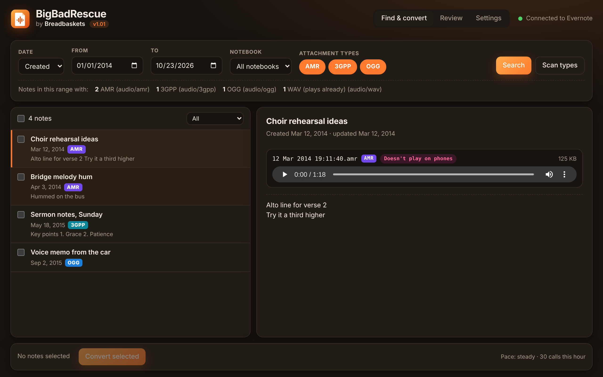
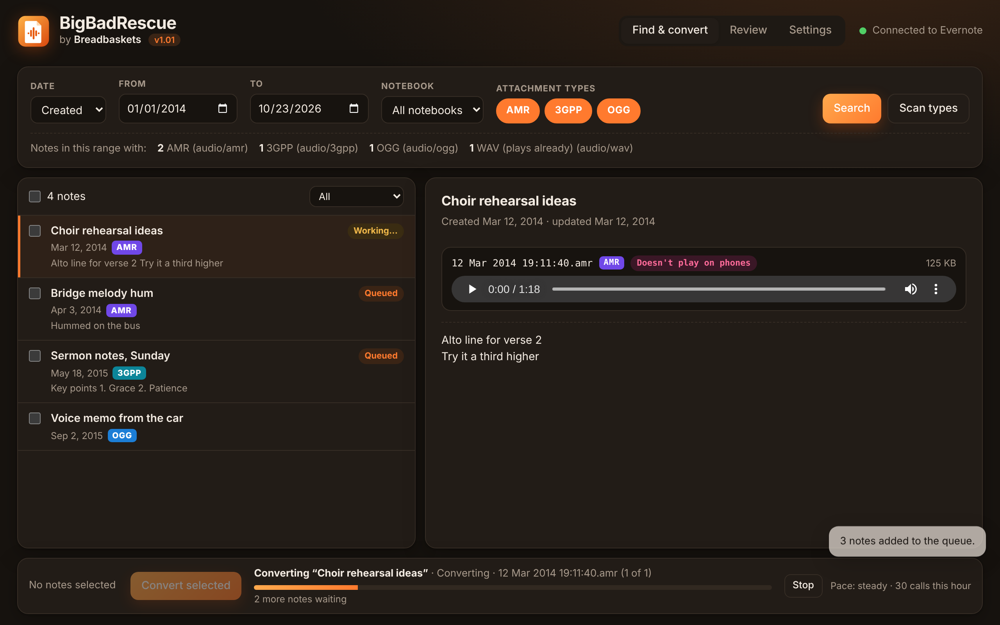
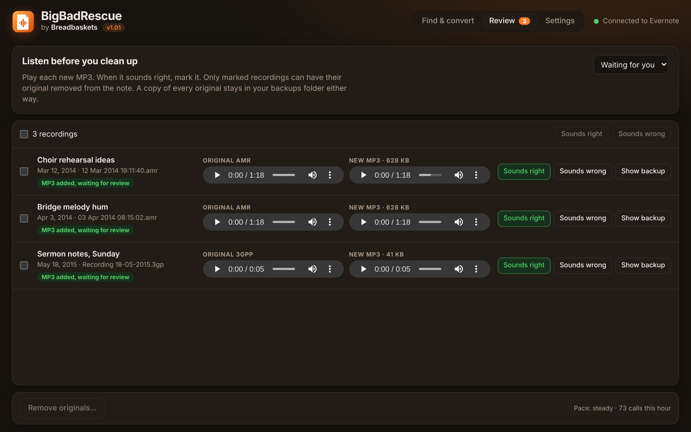
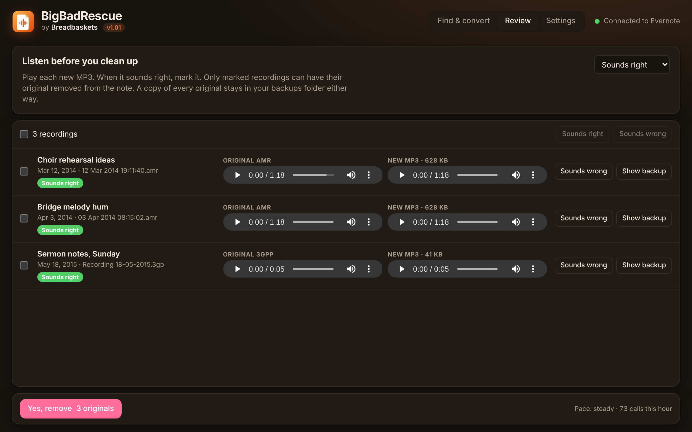
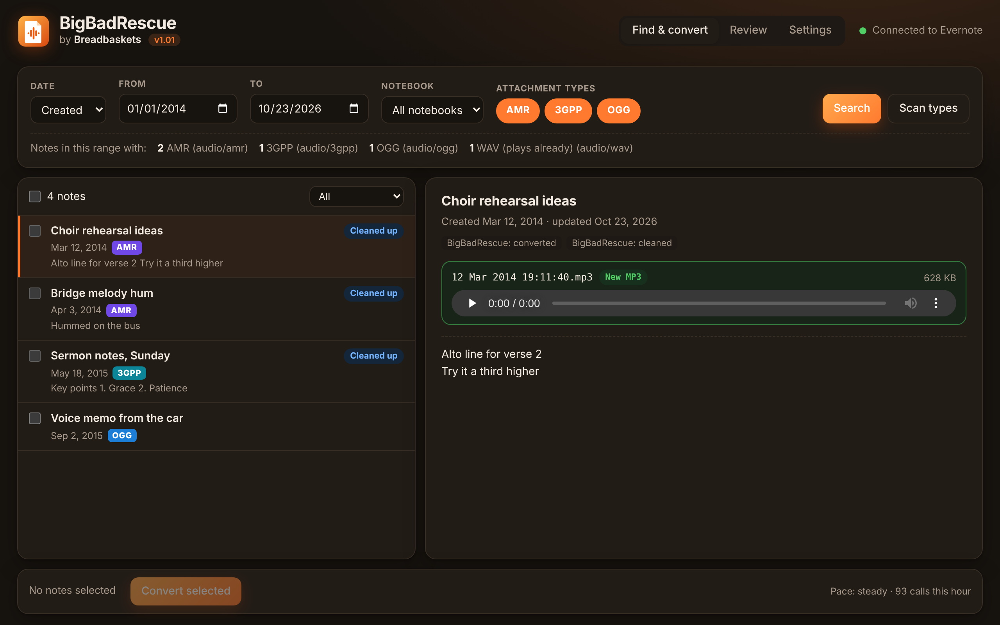
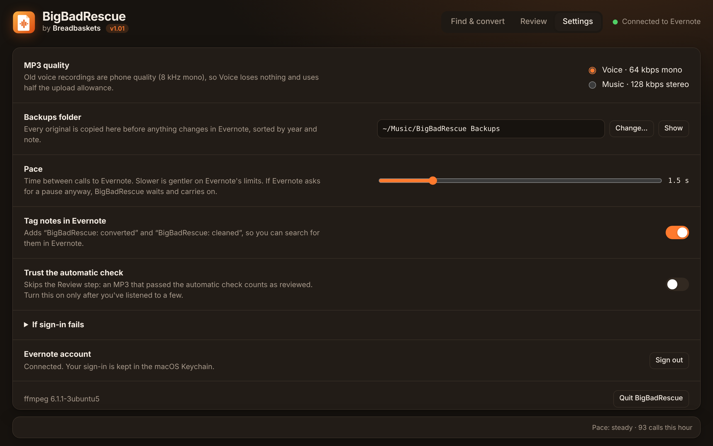

# BigBadRescue by Breadbaskets v1.01

Rescue old Evernote voice recordings that no longer play on your phone.



Years of Evernote notes carry audio in formats that Evernote's iPhone and Android apps no longer play: **AMR** (old Android voice notes), **3GPP** and **OGG**. They still play on the web, which isn't much use when you're out with your phone. BigBadRescue finds those notes and converts each recording to **MP3**. It puts the MP3 on the same note, and it removes the original only after you've said the MP3 sounds right.

- Free and open source (MIT). macOS 11 or later, Apple silicon or Intel.
- Signs in with your own Evernote account through Evernote's official MCP server. No API key is needed, and your sign-in stays in the macOS Keychain.
- Every original is backed up on your Mac before anything changes in Evernote.

BigBadRescue is an independent tool. It is not made, endorsed or supported by Evernote.

**[Download the latest release](https://github.com/FemoTheDon/bigbadrescue/releases/latest)**

## Install

1. Download `BigBadRescue-macOS.zip` from the [latest release](https://github.com/FemoTheDon/bigbadrescue/releases/latest) and unzip it.
2. Drag **BigBadRescue.app** to your Applications folder.
3. The app isn't signed by Apple, so macOS will refuse to open it at first. Open Terminal and run this once:
   ```bash
   xattr -cr /Applications/BigBadRescue.app
   ```
4. Open BigBadRescue. Its window opens as an app window in Chrome, Edge or Brave if you have one, and otherwise in your browser.
5. Press **Connect Evernote** at the top right and sign in on the Evernote page that opens. The dot turns green when you're connected.

ffmpeg, which does the conversion, is included in the app, so there's nothing else to install.

**Want to look around first?** Demo mode uses a pretend account with example notes, so nothing touches your real notes:

```bash
"/Applications/BigBadRescue.app/Contents/Resources/bin/bigbadrescue-$(uname -m)" -demo
```

## How to use it

### 1. Find your old recordings

On **Find & convert**, choose a date range (by the date the notes were created or last updated) and, if you like, a single notebook. The **AMR**, **3GPP** and **OGG** buttons choose which formats to look for. Press **Search**.

*Scan types* counts every kind of audio in the date range first, so you can see how many notes there are of each kind. WAV and MP3 already play on phones, so they're left alone.

Click a note to see its text and play its recordings on the right. AMR and 3GPP recordings are converted to a short preview so they can play in the window.

### 2. Convert

Tick the notes you want. Shift-click ticks everything between two notes, and the box at the top ticks the whole list. Then press **Convert selected**.



For each recording, BigBadRescue:

1. downloads it and checks it against Evernote's checksum,
2. **saves a backup copy** to `~/Music/BigBadRescue Backups/<year>/<date> <note title>/`,
3. converts it to MP3 (the Voice setting: 64 kbps mono),
4. **checks the MP3 plays**: it decodes the whole file, checks it runs as long as the original, and checks it isn't silent,
5. uploads the MP3 and puts it in the note under the original,
6. downloads the MP3 back from Evernote and checks it matches byte for byte,
7. tags the note `BigBadRescue: converted`.

The original stays on the note during this step. Progress shows at the bottom of the window. **Stop** ends the batch, and you can quit and come back later, because the app remembers where it got to. If a note has a problem, the app marks it **Problem** and moves on to the next. Choose *Problems* in the list's filter to find those notes, then convert them again.

### 3. Listen

The **Review** tab puts the original and the new MP3 side by side. Play them, and mark each one **Sounds right** or **Sounds wrong**. You can mark many at once with the tick boxes and the buttons at the top.



Once you trust it, you can switch on **Settings → Trust the automatic check**. Every MP3 that passes the automatic check then counts as sounding right, so you can skip this step.

### 4. Remove the originals

Press **Remove originals…**, then **Yes, remove N originals** to confirm. Only recordings you've marked as sounding right are removed. The note is then tagged `BigBadRescue: cleaned`. Your backup copies stay where they are.



Each note now has just the MP3, which plays on the phone.



### Start small

On your first run, pick a narrow date range and two or three notes. Check the MP3s on your phone and clean up just those before you do a big batch.

## Settings



- **MP3 quality.** Voice (64 kbps mono) is the default. Old voice notes are phone quality, so Voice loses nothing, and it uses half the upload allowance of Music (128 kbps stereo).
- **Backups folder.** Where the originals are copied.
- **Pace.** How long the app waits between calls to Evernote.
- **Tag notes in Evernote.** Adds the `BigBadRescue: converted` and `BigBadRescue: cleaned` tags so you can find those notes in Evernote.
- **Trust the automatic check.** Skips the listening step (see above).

## Good to know

**It remembers.** Every step is saved as it happens, in `~/Library/Application Support/BigBadRescue/memory.json`. A converted note shows a badge and can't be converted twice, even after a restart. A note that already has an MP3 with the same name is left alone.

**It's gentle with Evernote.** Calls are spaced out (1.5 seconds apart by default). If Evernote says "too many requests", everything pauses. A banner shows how long the wait is, and then the app carries on by itself. Converting one recording takes about 7 calls.

**Upload allowance.** Each MP3 counts against your monthly Evernote upload allowance. An 80-second AMR clip is about 125 KB, and it becomes about 630 KB as a Voice MP3.

**Old notes.** Evernote updates an old note to its new format the first time the note is edited. This is normal, and BigBadRescue allows for it.

## If something goes wrong

- **Sign-in fails.** BigBadRescue signs in at `http://127.0.0.1:47830/oauth/callback`, so port 47830 must be free. If Evernote refuses the sign-in, the error says so. In Settings → *If sign-in fails* you can enter a client ID that Evernote has issued, or the address of a client metadata document, and then restart the app.
- **A note shows Problem.** Click it to see the reason. Choose *Problems* in the list's filter, select those notes and convert them again. MP3s that were already uploaded are reused, so this doesn't use more of your upload allowance.
- **Logs.** The log is at `~/Library/Logs/BigBadRescue.log`.

Please report bugs on the [Issues](https://github.com/FemoTheDon/bigbadrescue/issues) page.

## Build from source

Needs Go 1.25+ and curl. Works on macOS or Linux.

```bash
go test ./...                      # unit and end-to-end tests (needs ffmpeg installed)
go run . -demo                     # try it against the built-in pretend Evernote
./packaging/build-mac-app.sh       # builds dist/BigBadRescue.app with ffmpeg bundled
```

The tests run the whole convert, review and cleanup cycle against a fake Evernote server, including a rate-limit pause and the OAuth sign-in. The fake copies the real server's behaviour, for example how it matches edits against old notes. Set `BIGBAD_TEST_AMR=/path/to/file.amr` to include a real AMR file. Most ffmpeg builds can read AMR but can't make it.

| Package | Job |
|---|---|
| `internal/evernote` | MCP client for `mcp.evernote.com` (official Go MCP SDK), OAuth 2.0 with PKCE and dynamic client registration, Keychain storage, signed download and upload links, ENML helpers |
| `internal/rescue` | Search, note viewer data, the convert and cleanup pipelines, the job queue |
| `internal/convert` | ffmpeg conversion with Voice and Music presets |
| `internal/verify` | Decode, duration, silence and checksum checks |
| `internal/pace` | Call spacing, pause and resume, backoff |
| `internal/store` | The memory file and settings |
| `internal/ui` | Local web server and the window |
| `internal/mock` | The fake Evernote used by tests and `-demo` |

Evernote MCP tools used: `search_notes`, `get_note`, `get_attachment`, `start_attachment_upload`, `finalize_attachment`, `edit_note`, `search_tags`, `create_tag`, `update_note_tags` and `search_notebooks`.

## Changes

- **v1.01.** Fixes the error "Evernote kept changing the note" on notes still in Evernote's old format. Evernote matches edits against the new format, so BigBadRescue now updates the note first and then finds the original again.
- **v1.0.** First release.

## Licence

MIT, see `LICENSE`. The bundled ffmpeg is GPL v3. See `THIRD-PARTY-NOTICES.md`.
